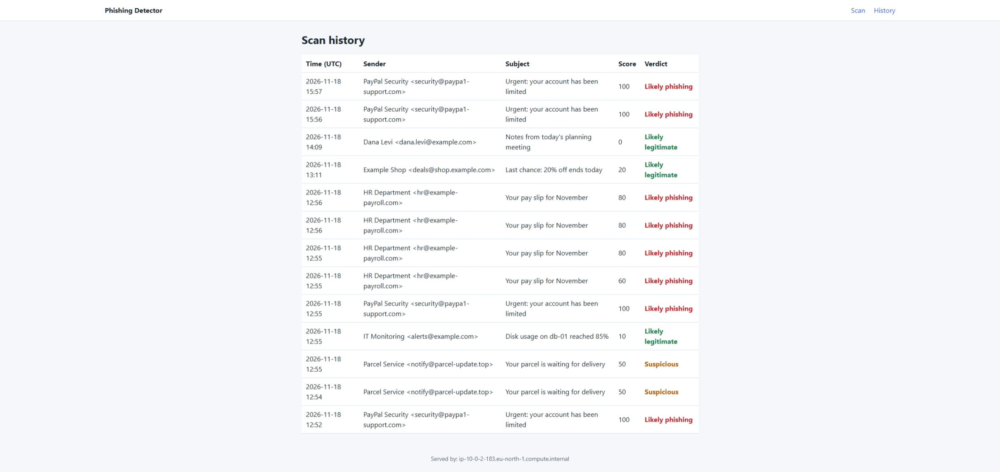
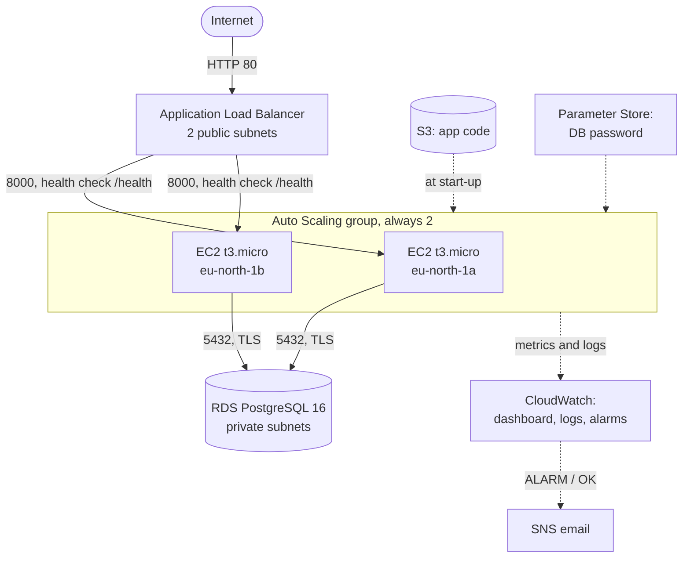
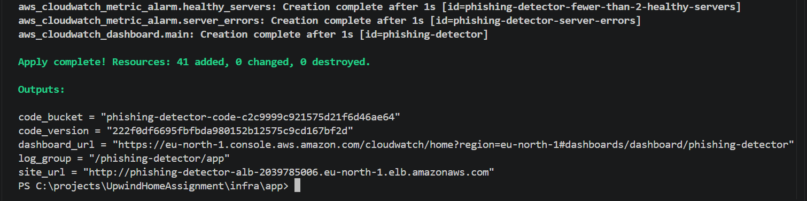
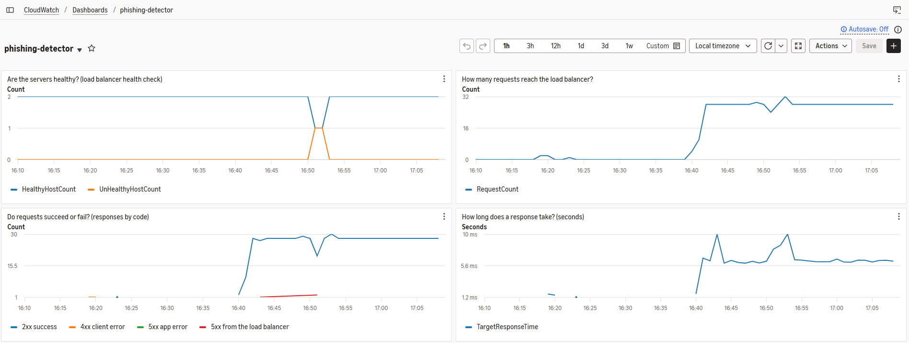
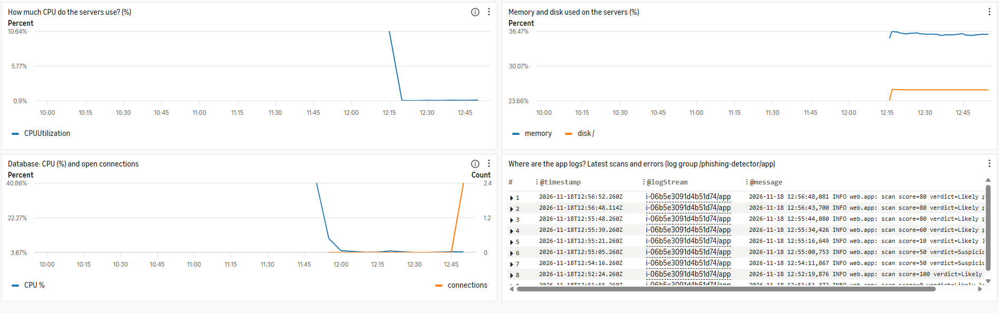
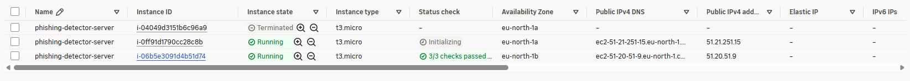
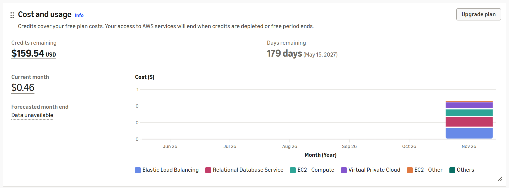
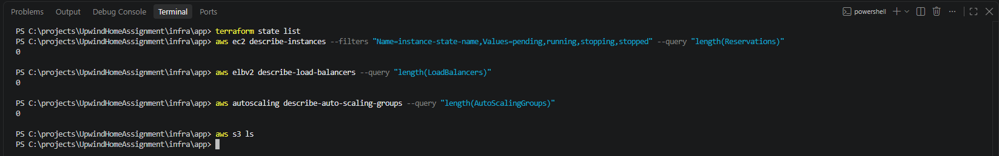

# Phishing Detector

A phishing email detector in Python, with a command-line tool and a web app.\
It is deployed on AWS with Terraform: two EC2 instances behind an Application Load Balancer, scan history in RDS PostgreSQL, and monitoring in CloudWatch.

**Contents**

- [Part 1: the detector](#part-1-the-detector)
  - [Run it locally](#run-it-locally)
  - [How detection works](#how-detection-works)
  - [Web UI](#web-ui)
- [Part 2: AWS](#part-2-aws)
  - [Architecture](#architecture)
  - [Deploy](#deploy)
  - [Monitoring](#monitoring)
  - [Failover test](#failover-test)
  - [Key decisions](#key-decisions)
  - [Known limitations](#known-limitations)
  - [Cost](#cost)
  - [Cleanup](#cleanup)
- [Project layout](#project-layout)

---

## Part 1: the detector

It reads an email file (`.eml`, or a `.txt` with `From:` / `Subject:` headers and a body).\
It looks for phishing indicators, and reports a verdict, a score, and every indicator it found with the evidence for it.

### Run it locally

Python 3.12.

```bash
python -m pip install -r requirements.txt

# Command line
python cli.py samples/phishing_paypal.txt
python cli.py --history samples/phishing_paypal.txt   # also uses and saves the scan history

# Web app, on http://127.0.0.1:5000
python -m flask --app web.app run

# Tests (168)
python -m pip install -r requirements-dev.txt
python -m pytest
```

The scan history is kept in a local SQLite file (`history.db`).\
`samples/` has six made-up emails, from legitimate (score 0) to phishing (score 100).

### How detection works

Every indicator has one of three levels, and each indicator counts once per email.\
The score is the sum, capped at 100.

| Level | Points | Asked as: how likely is this in a legitimate email? |
|---|---|---|
| High | 30 | Almost never |
| Medium | 20 | Sometimes |
| Low | 10 | Often |

**0-29** likely legitimate, **30-59** suspicious, **60-100** likely phishing.\
One high indicator alone is only "suspicious".\
Real phishing almost always shows several indicators, and fewer false alarms keep people trusting the tool.

| Group | Indicators (example) |
|---|---|
| Links | Public IP address instead of a domain name (`http://203.0.113.45/login`)<br>`@` in the address: the browser ignores everything before it, so the real destination is after it (`https://paypal.com@evil.net`)<br>Link text shows one domain, the link goes to another (text `paypal.com`, link `account-review.top`)<br>Domain that imitates a brand by swapping characters (`paypa1.com`)<br>Brand name in front of a domain it does not own (`paypal.com.account-verify.xyz`)<br>Unusual, commonly abused domain ending (`free-prizes.xyz`)<br>URL shortener that hides the destination (`bit.ly/3xParcel`)<br>Long, tangled address: more than 2 subdomains or 200 characters (`login.secure.account.update.example.com`)<br>Link without encryption (`http://example.com`) |
| Sender | Display name claims an organization, but the domain is not theirs (`PayPal Security <x@mail-verify.xyz>`)<br>Sender domain imitates a real one (`security@paypa1.com`)<br>Display name is itself a different email address (`"support@paypal.com" <x@evil.net>`)<br>Sender authentication failed, when the result is in the headers (`spf=fail`)<br>Brand name before the `@` (`paypal-billing@random-shop.com`)<br>Replies go to a different domain (from `company.com`, replies to `mail-verify.xyz`)<br>Unusual domain ending in the sender (`info@free-prizes.xyz`) |
| Wording<br>(English and Hebrew) | Time pressure (`within 24 hours`)<br>Threats (`account will be suspended`)<br>Asks for sensitive information (`verify your password`)<br>Prize or refund (`you have won`)<br>Payment demand (`outstanding payment`)<br>Generic greeting (`Dear customer`)<br>Asks to install or allow something (`enable macros`)<br>Shouting: 3 words in capitals, or `!!!` (`URGENT!!! ACT NOW`) |
| Attachments | File that runs code (`setup.exe`)<br>Name that hides the real type: double extension, hidden direction characters, or many spaces (`invoice.pdf.exe`)<br>Document with macros (`report.docm`)<br>HTML file, which can hold a fake login page (`login.html`)<br>Archive or disk image (`files.zip`) |
| History | The sender appeared before in an email scored 60 or more (`security@paypa1-support.com`)<br>A link domain appeared before as a suspicious link in an email scored 60 or more (`account-verify.xyz`) |

All the indicators and their points are in [`detector/config.py`](detector/config.py).\
The report shows the email itself as plain text (links are not clickable), and lists every link with its real target.

### Web UI

Upload a file (in Gmail: *More* (⋮), then *Download message*) or paste the email (in Gmail: *More* (⋮), then *Show original*, then *Copy to clipboard*).\
The history page lists earlier scans; the email body is never stored.\
The footer shows which server answered.

<p align="center">
  <a href="docs/screenshots/web-scan-page.png"></a>
  <a href="docs/screenshots/web-scan-result.png"></a>
  <a href="docs/screenshots/web-history.png"></a>
</p>

---

## Part 2: AWS

### Architecture



The servers run the same code as a laptop.\
Only the `DATABASE_URL` environment variable changes: on AWS it points to PostgreSQL in RDS instead of a local SQLite file.

Security groups form rings: the load balancer accepts port 80 from anywhere, the servers accept port 8000 only from the load balancer, and the database accepts port 5432 only from the servers.

The Terraform code is in two parts:

| Part | What it holds | Lifetime |
|---|---|---|
| [`infra/base`](infra/base) | VPC, subnets, security groups of the servers and the database, RDS, the database password, the budget, the log group, the alarm email channel | Created once and kept |
| [`infra/app`](infra/app) | Load balancer, Auto Scaling group, launch template, S3 code bucket, IAM role, alarms, dashboard | Applied and destroyed in every work session |

`infra/app` reads what it needs from the state of `infra/base` (`terraform_remote_state`).

### Deploy

Requirements: Terraform 1.17, AWS CLI v2, and a sign-in with `aws login` (temporary credentials, no access keys).\
Everything runs in **eu-north-1**.\
The commands start from the repository's root folder.

```bash
# 1. Once: the base (RDS takes about 8 minutes)
cd infra/base
cp terraform.tfvars.example terraform.tfvars   # put your email address in it
terraform init
terraform plan -out base.tfplan
terraform apply base.tfplan
# Then click "Confirm subscription" in the email from AWS (once).
```

```bash
# 2. Every session: the app
aws rds start-db-instance --db-instance-identifier phishing-detector-db   # if it was stopped
cd infra/app
terraform init
terraform plan -out app.tfplan
terraform apply app.tfplan        # prints site_url and dashboard_url
```

The servers install themselves in about one minute.\
A few minutes after each apply, the "fewer than 2 healthy servers" alarm emails ALARM and then OK: at first there is no data yet, and no data counts as a problem.\
The load balancer's address changes with every apply, so open the `site_url` from the output.

<a href="docs/screenshots/terraform-apply.png"></a>

### Monitoring

One CloudWatch dashboard, `phishing-detector`, answers the questions of the assignment.\
Each graph is titled with its question.

| Question of the assignment | Dashboard graph |
|---|---|
| Are the EC2 instances healthy? | *Are the servers healthy? (load balancer health check)* |
| How much CPU or system resources? | *How much CPU do the servers use? (%)*<br>*Memory and disk used on the servers (%)* |
| How many requests reach the load balancer? | *How many requests reach the load balancer?* |
| Are requests succeeding or failing? | *Do requests succeed or fail? (responses by code)* |
| Where can the application logs be viewed? | *Where are the app logs? Latest scans and errors (log group /phishing-detector/app)* |

Two more graphs show the response time (for the bonus "consider performance issues") and the database (CPU and open connections).\
The full logs are in CloudWatch Logs, log group `/phishing-detector/app`, with one stream per server for the set-up, app and access logs.

Two alarms send an email through SNS, both when they start (ALARM) and when they end (OK):

- **Fewer than 2 healthy servers** in two minutes (no data counts as a problem).
- **Any 5xx from the app** (traffic is low, so every error matters).

<a href="docs/screenshots/dashboard-health-and-traffic.png"></a>
<a href="docs/screenshots/dashboard-resources-and-logs.png"></a>
<a href="docs/screenshots/cloudwatch-log-streams.png"></a>

The log group is in `infra/base`, so the logs outlive the servers and the nightly destroy.

### Failover test

One server was terminated from the EC2 console while a loop kept requesting the site:

| Time after terminate | What happened |
|---|---|
| 0 | Server terminated; the other server kept serving (2 requests got a 502) |
| 33 s | Auto Scaling started a replacement in the same Availability Zone |
| ~2 min | The new server passed the health check; two servers again |
| 4 min 40 s | ALARM email |
| 5 min 40 s | OK email |

The alarm emails arrive a few minutes late: the load balancer's metrics reach CloudWatch with a delay, and the alarm waits for two minutes in a row.\
The alarm matters most when the automatic fix does not work, unlike here.

<a href="docs/screenshots/failover-ec2-instances.png"></a>
<a href="docs/screenshots/failover-alarm-email.png"></a>
<a href="docs/screenshots/failover-ok-email.png"></a>

If the app process itself crashes, systemd restarts it within 3 seconds, before the load balancer notices.

### Key decisions

| Decision | Why |
|---|---|
| `aws login` with MFA, no IAM user or access keys | No long-lived keys on the laptop that could leak |
| Own VPC, servers in public subnets, no NAT Gateway | A NAT Gateway costs about $1 a day, more than everything else; the security groups protect the servers |
| Auto Scaling group fixed at 2, one per AZ, ELB health check | A failed server is replaced automatically, also when the app on it stops answering |
| gunicorn (2 workers) under systemd | A crashed app restarts in seconds |
| Servers get the app code from a private, encrypted S3 bucket | No GitHub credentials on the servers: they read S3 with their IAM role.<br>A code change replaces the servers one at a time |
| Session Manager instead of SSH | No open port and no keys; access goes through IAM |
| RDS PostgreSQL, db.t4g.micro, single-AZ, encrypted, not public, deletion protection | Cheapest managed option; Multi-AZ would double the price, and scans keep working without the database |
| Random DB password in Parameter Store (SecureString) | Never in the code or in Git; only the servers' role can read it; the connection uses TLS |
| `/health` (health check) checks only the app | A database outage does not take both servers out of service |
| Logs and the alarm email channel in `infra/base` | They outlive the nightly destroy, and the email is confirmed only once |
| Budget of $10 with email alerts | An email when the monthly cost passes $5 and $10, so an unexpected cost shows up early |
| `Project` tag on every resource | One search by the tag lists every resource of the project, so leftovers after a destroy are easy to find |

### Known limitations

- HTTP only: there is no domain, so no HTTPS certificate.\
  A real deployment needs both.
- The servers are in public subnets: one layer of protection (security groups) instead of two.
- RDS is in one Availability Zone; if it fails, scanning still works, without history.
- The database password is also in the local Terraform state file; the app connects as the database's main user.
- The detector matches words and patterns and does not understand context; it does not open attachments, and it does not catch look-alike letters from other alphabets.
- On a brand-new account, the first apply can fail once while AWS creates the Auto Scaling service role.\
  Running `apply` again fixes it.

### Cost

Expected total for the whole project: a few dollars out of the $100 credit.\
The servers and the load balancer exist only while working, and RDS is stopped between sessions.\
A $10 monthly budget sends an email at $5 and $10.\
Cost so far (19 November, after two days of work): $0.46.

<a href="docs/screenshots/cost.png"></a>

### Cleanup

The assignment asks to run `terraform destroy` and verify that the resources were removed.\
`infra/app` is destroyed and verified at the end of every work session (screenshots below), and `infra/base` in the final cleanup.

```bash
# End of every session
cd infra/app
terraform plan -destroy -out destroy.tfplan
terraform apply destroy.tfplan
aws rds stop-db-instance --db-instance-identifier phishing-detector-db
```

<a href="docs/screenshots/terraform-destroy.png"></a>
<a href="docs/screenshots/terraform-destroy-verify.png"></a>

Final cleanup: set `deletion_protection = false` in [`infra/base/database.tf`](infra/base/database.tf), apply, then `terraform destroy` in `infra/base`.

---

## Project layout

```text
detector/      the detector: parsing, checks, scoring
cli.py         command-line tool
web/           Flask web app and the history storage
tests/         automated tests (pytest)
samples/       six made-up emails
infra/base/    Terraform: network, database, logs, alerts (kept)
infra/app/     Terraform: load balancer, servers, monitoring (destroyed after use)
docs/          screenshots
```
