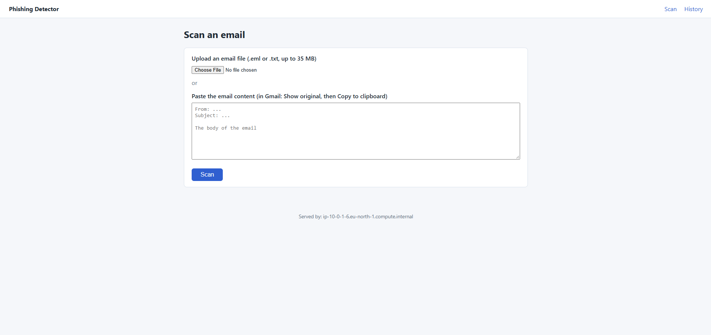
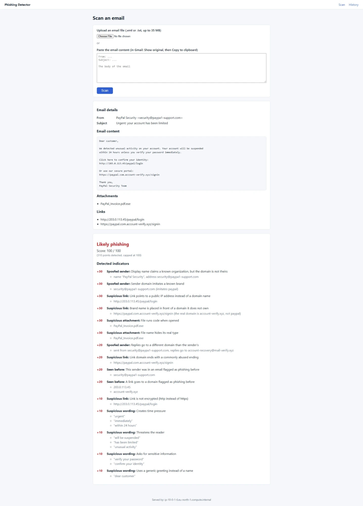
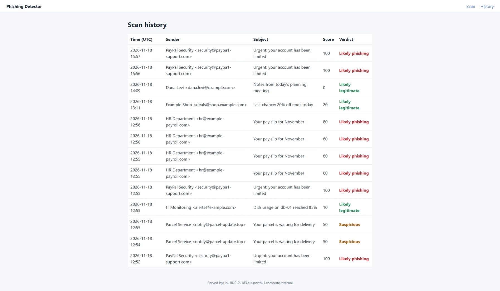
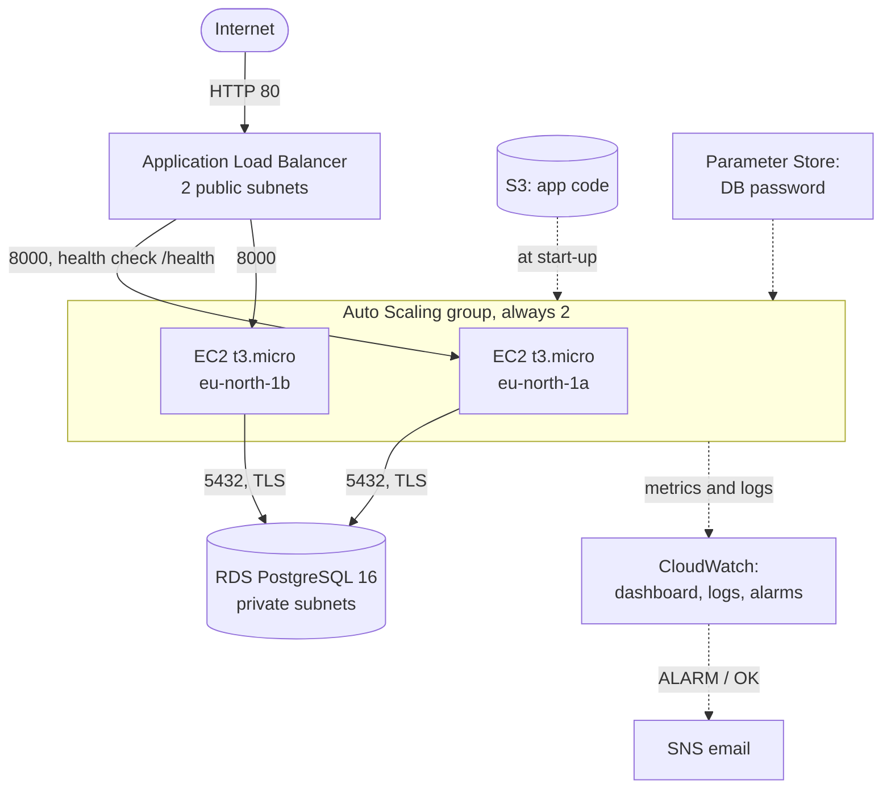
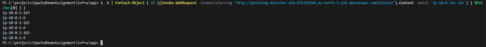
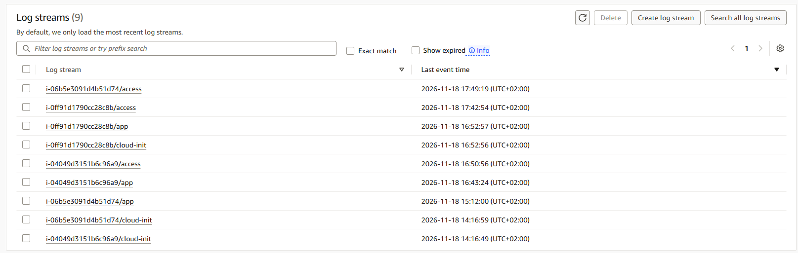
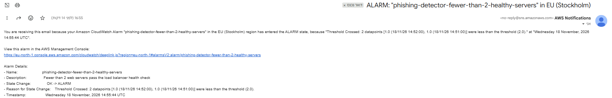
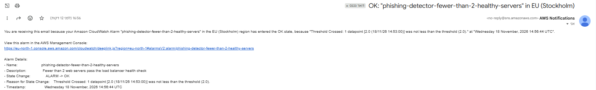
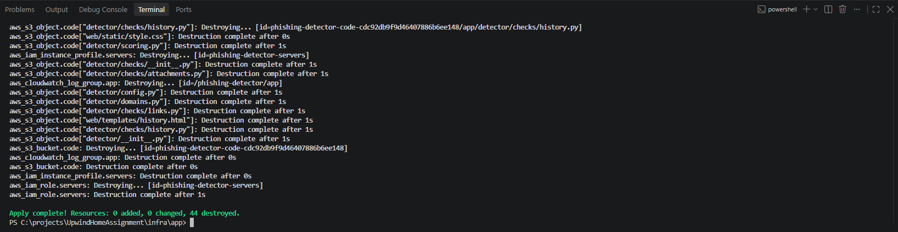

# Phishing Detector

A phishing email detector in Python, with a command-line tool and a small web
app, deployed on AWS with Terraform: two EC2 instances behind an Application
Load Balancer, scan history in RDS PostgreSQL, and monitoring in CloudWatch.

**Contents**

- [Part 1: the detector](#part-1-the-detector)
  - [Run it locally](#run-it-locally)
  - [How detection works](#how-detection-works)
  - [Web UI](#web-ui)
- [Part 2: AWS](#part-2-aws)
  - [Architecture](#architecture)
  - [Deploy](#deploy)
  - [Monitoring](#monitoring)
  - [Failover test](#failover-test)
  - [Key decisions](#key-decisions)
  - [Known limitations](#known-limitations)
  - [Cost and cleanup](#cost-and-cleanup)
- [Project layout](#project-layout)

---

## Part 1: the detector

It reads an email file (`.eml`, or a `.txt` with `From:` / `Subject:` headers
and a body), looks for phishing indicators, and reports a verdict, a score,
and every indicator it found with the evidence for it.

### Run it locally

Python 3.12.

```bash
python -m pip install -r requirements.txt

# Command line
python cli.py samples/phishing_paypal.txt
python cli.py --history samples/phishing_paypal.txt   # also uses and saves the scan history

# Web app, on http://127.0.0.1:5000
python -m flask --app web.app run

# Tests (168)
python -m pip install -r requirements-dev.txt
python -m pytest
```

Locally the history is kept in a SQLite file (`history.db`). On AWS the same
code uses PostgreSQL in RDS: only the `DATABASE_URL` environment variable
changes. `samples/` has six made-up emails, from legitimate (score 0) to
phishing (score 100).

### How detection works

Every indicator has one of three levels, and each indicator counts once per
email. The score is the sum, capped at 100.

| Level | Points | Asked as: how likely is this in a legitimate email? |
|---|---|---|
| High | 30 | Almost never |
| Medium | 20 | Sometimes |
| Low | 10 | Often |

**0-29** likely legitimate, **30-59** suspicious, **60-100** likely phishing.
One high indicator alone is only "suspicious": real phishing almost always
shows several indicators, and fewer false alarms keep people trusting the tool.

| Group | Examples of indicators |
|---|---|
| Links | public IP instead of a domain, `paypal.com@evil.net`, link text that shows a different domain, look-alike brand (`paypa1.com`), brand in a subdomain (`paypal.com.account-verify.xyz`), URL shortener, unusual TLD |
| Sender | display name claims a brand the domain does not belong to, look-alike sender domain, `Reply-To` in a different domain, failed SPF/DKIM/DMARC result in the headers |
| Wording | urgency, threats, requests for passwords or card details, prizes and refunds, payment demands, generic greeting, shouting (English and Hebrew) |
| Attachments | files that run code (`.exe`, `.js`, `.lnk`...), double extensions (`invoice.pdf.exe`), hidden right-to-left characters, macro documents, HTML files, archives |
| History | the sender, or a link domain, appeared before in an email scored 60 or more |

All the numbers and lists are in [`detector/config.py`](detector/config.py).
The report shows the email itself as plain text (links are not clickable), and
lists every link with its real target.

### Web UI

Upload a file or paste the email (in Gmail: *Show original*, then *Copy to
clipboard*). The history page lists earlier scans; the email body is never
stored. The footer shows which server answered.

<p>
  <a href="docs/screenshots/web-scan-page.png"></a>
  <a href="docs/screenshots/web-scan-result.png"></a>
  <a href="docs/screenshots/web-history.png"></a>
</p>

---

## Part 2: AWS

### Architecture



Security groups form rings: the load balancer accepts port 80 from anywhere,
the servers accept port 8000 only from the load balancer, and the database
accepts port 5432 only from the servers. No port 22 is open anywhere.

The Terraform code is in two parts:

| Part | What it holds | Lifetime |
|---|---|---|
| [`infra/base`](infra/base) | VPC, subnets, security groups of the servers and the database, RDS, the database password, the budget, the log group, the alarm email channel | Created once and kept |
| [`infra/app`](infra/app) | Load balancer, Auto Scaling group, launch template, S3 code bucket, IAM role, alarms, dashboard | Applied and destroyed in every work session (and in the demo) |

`infra/app` reads what it needs from the state of `infra/base`
(`terraform_remote_state`).

### Deploy

Requirements: Terraform 1.17, AWS CLI v2, and a sign-in with `aws login`
(temporary credentials, no access keys). Everything runs in **eu-north-1**,
the only region the AWS account allows.

```bash
# 1. Once: the base (RDS takes about 8 minutes)
cd infra/base
cp terraform.tfvars.example terraform.tfvars   # put your email address in it
terraform init
terraform plan -out base.tfplan
terraform apply base.tfplan
# Then click "Confirm subscription" in the email from AWS (once).

# 2. Every session: the app
aws rds start-db-instance --db-instance-identifier phishing-detector-db   # if it was stopped
cd ../app
terraform init
terraform plan -out app.tfplan
terraform apply app.tfplan        # prints site_url and dashboard_url
```

The servers install themselves in about one minute. The load balancer's
address changes with every apply, so open the `site_url` from the output.

<a href="docs/screenshots/load-balancing-served-by.png"></a>

### Monitoring

One CloudWatch dashboard, `phishing-detector`, answers the questions of the
assignment. Each graph is titled with its question.

| Question | Where |
|---|---|
| Are the EC2 instances healthy? | Healthy / unhealthy hosts, from the load balancer health check |
| How much CPU and system resources? | CPU per Auto Scaling group; memory and disk from the CloudWatch agent |
| How many requests reach the load balancer? | Request count |
| Are requests succeeding or failing? | 2xx, 4xx and 5xx from the servers, and 5xx from the load balancer itself |
| Where are the application logs? | CloudWatch Logs, log group `/phishing-detector/app`, one stream per server for set-up, app and access logs; the latest scans and errors are also on the dashboard |

Two alarms send an email through SNS, on ALARM and on OK:

- **Fewer than 2 healthy servers** in two consecutive minutes (no data counts as a problem).
- **Any 5xx from the app** in a minute (traffic is low, so every error matters).

<a href="docs/screenshots/dashboard-health-and-traffic.png"></a>
<a href="docs/screenshots/dashboard-resources-and-logs.png"></a>
<a href="docs/screenshots/cloudwatch-log-streams.png"></a>

The log group is in `infra/base`, so the logs outlive the servers and the
nightly destroy (the streams above include a server that had been terminated).

### Failover test

One server was terminated from the EC2 console while a loop kept requesting
the site:

| Time after terminate | What happened |
|---|---|
| 0 | Server terminated; the other server kept serving (2 requests got a 502) |
| 33 s | Auto Scaling started a replacement in the same Availability Zone |
| ~2 min | The new server passed the health check; two servers again |
| 4 min 40 s | ALARM email |
| 5 min 40 s | OK email |

<a href="docs/screenshots/failover-ec2-instances.png"></a>
<a href="docs/screenshots/failover-alarm-email.png"></a>
<a href="docs/screenshots/failover-ok-email.png"></a>

If the app process itself crashes, systemd restarts it within 3 seconds,
before the load balancer notices.

### Key decisions

| Decision | Why |
|---|---|
| `aws login` with MFA, no IAM user or access keys | No long-lived keys on the laptop that could leak |
| Region eu-north-1 | The only region the account allows; prices are close to us-east-1 |
| Own VPC, servers in public subnets, no NAT Gateway | A NAT Gateway costs about $1 a day, more than everything else; the security groups protect the servers |
| Auto Scaling group fixed at 2, one per AZ, ELB health check | A failed server is replaced automatically, also when the app on it stops answering |
| gunicorn (2 workers) under systemd | A crashed app restarts in seconds |
| App code from a private, encrypted S3 bucket | No Git credentials on the servers; a code change replaces the servers one at a time |
| Session Manager instead of SSH | No open port and no keys; access goes through IAM |
| RDS PostgreSQL, db.t4g.micro, single-AZ, encrypted, not public, deletion protection | Cheapest managed option; Multi-AZ would double the price, and scans keep working without the database |
| Random DB password in Parameter Store (SecureString) | Never in the code or in Git; only the servers' role can read it; the connection uses TLS |
| Health check `/health` checks only the app | A database outage does not take both servers out of service |
| Logs and the alarm email channel in `infra/base` | They outlive the nightly destroy, and the email is confirmed only once |
| Budget of $10 with email alerts, `Project` tag on every resource | Costs stay visible, and leftovers are easy to find |

### Known limitations

- HTTP only: there is no domain, so no HTTPS certificate. A real deployment needs both.
- The servers are in public subnets: one layer of protection (security groups) instead of two.
- RDS is in one Availability Zone; if it fails, scanning still works, without history.
- The database password is also in the local Terraform state file; the app connects as the database's main user.
- The detector matches words and patterns and does not understand context; it does not open attachments, and it does not catch look-alike letters from other alphabets (such as Cyrillic `а`).
- A sender that spoofs the exact real address is caught only if the email includes the SPF/DKIM/DMARC results.
- On a brand-new account, the first apply can fail once while AWS creates the Auto Scaling service role; running `apply` again fixes it.

### Cost and cleanup

Expected total for the whole project: a few dollars out of the $100 credit.
The servers and the load balancer exist only while working, and RDS is stopped
between sessions.

```bash
# End of every session
cd infra/app
terraform plan -destroy -out destroy.tfplan
terraform apply destroy.tfplan
aws rds stop-db-instance --db-instance-identifier phishing-detector-db
```

<a href="docs/screenshots/terraform-destroy.png"></a>
<a href="docs/screenshots/terraform-destroy-verify.png"></a>

Final cleanup: set `deletion_protection = false` in
[`infra/base/database.tf`](infra/base/database.tf), apply, then
`terraform destroy` in `infra/base`.

---

## Project layout

```text
detector/      the detector: parsing, checks, scoring
cli.py         command-line tool
web/           Flask web app and the history storage
tests/         automated tests (pytest)
samples/       six made-up emails
infra/base/    Terraform: network, database, logs, alerts (kept)
infra/app/     Terraform: load balancer, servers, monitoring (destroyed after use)
docs/          screenshots
```
